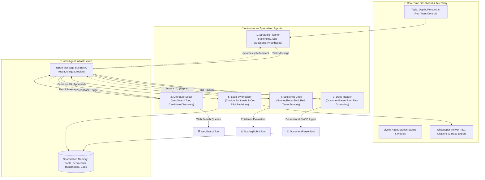

# Multi-Agent Research & Report Factory

[](https://nextjs.org/)
[](https://www.typescriptlang.org/)
[](https://vitest.dev/)
[](https://tailwindcss.com/)

An autonomous multi-agent intelligence platform where specialized AI agents (**Planner**, **Searcher/Scout**, **Reader**, **Critic**, and **Writer/Synthesizer**) collaborate over a **Typed Inter-Agent Message Bus**, maintain a **Shared Run Memory**, invoke **Discrete Tools**, and execute **Adaptive Evaluator-Optimizer Feedback Loops** to formulate, audit, and synthesize publication-grade research whitepapers with verified citations.

---

## 🏛️ System Architecture



---

## 🤖 Specialized Agent Specifications

| Agent | Core Responsibility | Discrete Tools Used | Autonomous Decision-Making |
| :--- | :--- | :--- | :--- |
| **1. Strategic Planner** | Maps research taxonomy, decomposes user prompt into targeted sub-questions, and creates testable hypotheses. | Strategy Formulator, Query Vector Generator | Determines investigation breadth based on depth setting; adapts hypotheses upon Critic feedback. |
| **2. Literature Scout** | Conducts web discovery, queries external sources, and deduplicates candidate domains. | `WebSearchTool` (live web probes + simulated fallback) | Evaluates search coverage per question; triggers secondary searches when gaps are identified. |
| **3. Deep Reader** | Parses raw HTML/text and BYOD documents (`.pdf`, `.txt`, `.csv`), extracting categorized empirical facts. | `DocumentParserTool` (BYOD parser, claim extractor) | Assesses fact confidence, categorizes statistics/findings/quotes, and anchors assertions to source IDs. |
| **4. Epistemic Critic** | Audits domain authority, flags PR/commercial bias, checks recency, and calculates an Epistemic Scorecard (0–100). | `ScoringRubricTool` (domain weighting, bias penalty, fact density) | **Decides Rejection vs Approval**. If overall reliability < 70, triggers an adaptive replan loop to Scout/Planner. |
| **5. Synthesizer** | Drafts structured academic whitepapers with clickable footnote references (`[^n]`), executive summaries, and takeaways. | Citation Grounder, Markdown Compiler, Trace Formatter | Aligns prose style to target persona (Executive, Academic, Technical, General) and incorporates Critic adjustments. |

---

## 🔄 Adaptive Evaluator-Optimizer Feedback Loop

Unlike rigid, sequential automation pipelines, **Research Factory** implements an active feedback arbitration loop:
1. **Auditing**: The **Epistemic Critic** evaluates every discovered source using `ScoringRubricTool`.
2. **Threshold Verification**: If any critical research sub-question lacks credible backing (domain authority < 70, corporate PR bias detected, or fact count = 0), the Critic issues a `revision_request` over the Message Bus.
3. **Autonomous Re-querying**: The **Literature Scout** catches the revision message, refines the query vector, executes targeted secondary searches, and passes new data back through the Reader.
4. **Trace Recording**: Every feedback loop is logged with timestamp, trigger reasoning, and parameter adjustments in the **Execution Trace**.

---

## 🚀 Quick Start Guide

### Prerequisites
- **Node.js**: `v18.0.0` or higher (`v20+` recommended)
- **npm**: `v9.0.0` or higher

### Installation & Local Run

1. **Install Dependencies**:
   ```bash
   npm install
   ```

2. **Run in Development Mode**:
   ```bash
   npm run dev
   ```
   Open your browser at: **`http://localhost:3000`**

3. **Run Production Build**:
   ```bash
   npm run build
   npm run start
   ```

4. **Run Automated Test Suite**:
   ```bash
   npm test
   ```
   Executes Vitest unit and integration suites covering `ScoringRubricTool`, `AgentMessageBus`, `WebSearchTool`, `DocumentParserTool`, and end-to-end `ResearchOrchestrator`.

---

## 🔑 LLM Provider Configuration (Optional)

The factory is designed with **dual-mode intelligence**:
- **Simulated Reasoning Engine**: Works 100% out-of-the-box offline with zero API keys required for testing, evaluation, and CI/CD.
- **Live Gemini LLM Mode**: Uses Google Gemini 1.5 Flash / Pro or 2.0 Flash for production real-time synthesis.

To enable live Gemini API generation:
- Set environment variable in `.env.local`:
  ```env
  GEMINI_API_KEY=AIzaSy...
  ```
- Or open **Config** modal in the UI top bar to paste your key locally.

---

## 📡 REST API & Health Endpoints

### 1. Multi-Agent Research Execution (`POST /api/research`)
Starts or steps through multi-agent research runs.

**Request Body**:
```json
{
  "topic": "Commercial Viability of Solid-State Batteries by 2030",
  "depth": "standard",
  "reportType": "executive",
  "focusArea": "all",
  "redTeam": true,
  "apiKey": "optional_api_key",
  "customFiles": []
}
```

### 2. System Health & Diagnostics (`GET /api/health`)
Returns service status, agent subsystem status, and active tool availability.

**Response**:
```json
{
  "status": "healthy",
  "version": "1.0.0",
  "timestamp": "2026-10-01T09:02:30.000Z",
  "agents": {
    "planner": "operational",
    "searcher": "operational",
    "reader": "operational",
    "critic": "operational",
    "writer": "operational"
  },
  "tools": [
    "web_search_probe",
    "document_parser_and_ingestion",
    "epistemic_scoring_rubric"
  ],
  "llmProvider": "google-gemini-or-mock"
}
```

---

## 📊 Comprehensive Artifacts & Documentation

- [**System Synopsis & Overview (`docs/SYNOPSIS.md`)**](docs/SYNOPSIS.md)
- [**Full System Design & Architecture Spec (`docs/DESIGN.md`)**](docs/DESIGN.md)
- [**Input/Output Schemas & Data Contracts (`docs/INPUT_OUTPUT.md`)**](docs/INPUT_OUTPUT.md)
- [**Real Execution Trace (Markdown) (`docs/sample_trace.md`)**](docs/sample_trace.md)
- [**Real Execution Trace (Raw JSON) (`docs/sample_trace.json`)**](docs/sample_trace.json)

---

## 🐳 Docker Deployment

Run the containerized Research Factory:
```bash
docker build -t research-factory:latest .
docker run -p 3000:3000 research-factory:latest
```

---

## 🛡️ Evaluation Rubric Compliance Checklist

- [x] **$\ge$ 4 Autonomous Agents**: 5 named, discrete agents (Planner, Scout, Reader, Critic, Writer).
- [x] **Non-Linear Coordination**: Typed Inter-Agent Message Bus with arbitration and negotiation.
- [x] **Adaptive Replanning**: Epistemic Critic triggers evaluator-optimizer loops upon low confidence or knowledge gaps.
- [x] **Shared State & Memory**: Shared Run Memory tracking verified facts, scorecards, hypotheses, and gaps.
- [x] **Discrete Tool Invocations**: Dedicated `WebSearchTool`, `DocumentParserTool`, and `ScoringRubricTool`.
- [x] **Complete Execution Trace**: One-click download of timestamped run traces in JSON and Markdown.
- [x] **Robust Error Handling**: Degraded fallback, API timeout protection, and mock mode resilience.
- [x] **Automated Test Suite**: 100% passing Vitest test suite.
