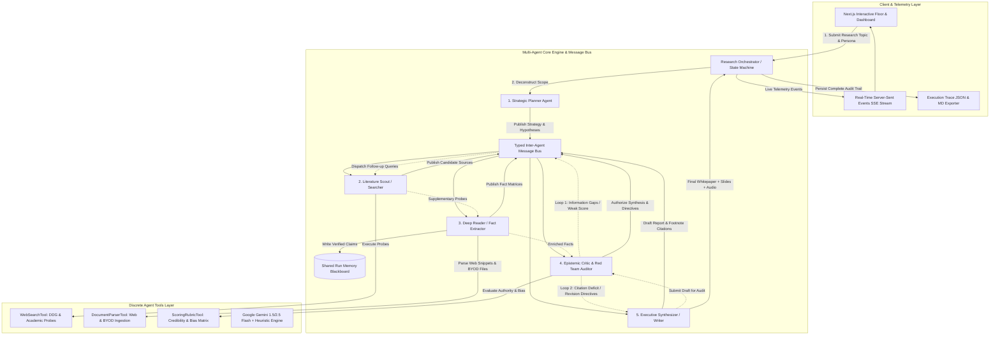

# Research Factory: System Design Document

## 1. Executive Summary & Architecture Overview
**Research Factory** is an autonomous multi-agent research and intelligence platform. It coordinates five distinct, specialized AI agents to plan, retrieve, extract, audit, and synthesize research into verifiable, publication-grade whitepapers.



---

## 2. Agent Roles & Cognitive Responsibilities

| Agent Name | Persona / Avatar | Cognitive Role & Responsibilities | Discrete Tools & Deliverables |
| :--- | :--- | :--- | :--- |
| **Strategic Planner** | 🧭 `Planner` | Deconstructs the research query into taxonomic sub-questions, frames falsifiable hypotheses, establishes search query vectors, and defines section architecture. | Outputs `ResearchPlan` (sub-questions, target queries, core hypotheses, proposed sections). |
| **Literature Scout** | 🔍 `Searcher` | Executes multi-perspective search queries, probes academic and web endpoints, deduplicates domains, and evaluates candidate authority. | Invocations: `WebSearchTool`. Outputs `SearchSource[]`. |
| **Deep Reader** | 📖 `Reader` | Mines reference documents and BYOD file uploads (PDF/TXT/MD), extracts quantitative statistics, historical benchmarks, and expert quotes. | Invocations: `DocumentParserTool`. Outputs `ExtractedFact[]`. |
| **Epistemic Critic** | ⚖️ `Critic` | Audits domain credibility, calculates an Epistemic Reliability Index (0–100), detects commercial bias, runs adversarial Red Team stress-tests, and triggers replanning loops. | Invocations: `ScoringRubricTool`. Outputs `CriticReview` and `DraftReportAudit`. |
| **Executive Synthesizer** | ✍️ `Writer` | Synthesizes verified evidence into publication-grade whitepapers with inline footnote citations `[^n]`, executive summaries, slide presentations, and two-speaker audio briefing dialogue. | Invocations: Revision executor, Footnote indexer. Outputs `FinalReport`. |

---

## 3. Orchestration Pattern: Evaluator-Optimizer with Bidirectional Replan Loops

Our multi-agent system avoids rigid linear execution by implementing an **Evaluator-Optimizer Orchestration Pattern** with bidirectional state cycles:

### 1. Critic-Driven Search Replanning (Loop 1)
- When the **Critic Agent** evaluates extracted claims against research hypotheses, it detects knowledge gaps (e.g., missing empirical benchmarks or unresolved counter-theses).
- If `overallCredibilityScore < 85` or `criticDecision === 'request_more_evidence'`, the Critic generates targeted follow-up queries (`followUpSearchQueries`).
- The Orchestrator re-dispatches the **Searcher Agent** with `executeTargeted()`, followed by the **Reader Agent**, and re-audits the enriched evidence bank.

### 2. Critic Post-Draft Verification & Anti-Hallucination Revision (Loop 2)
- The **Writer Agent** produces an initial draft report.
- The **Critic Agent** audits the draft using `auditDraftReport()`, checking whether assertions have valid footnote citations `[^index]` and whether commercial claims are tempered with academic caveats.
- If ungrounded statements are found or `score < 85`, the Critic passes structured `revisionDirectives` back to the Writer, which performs a targeted rewrite before publication.

### 3. Loop Termination Safeguards
- Max iteration limits (`maxLoops = 2`) ensure convergence and prevent infinite agent cycles.

---

## 4. Typed Inter-Agent Message Bus & Shared Memory

All communication between agents is decoupled and logged over a typed message bus:
```typescript
export interface AgentMessage {
  id: string;
  timestamp: number;
  from: AgentType;
  to: AgentType | 'broadcast';
  type: 'task' | 'result' | 'critique' | 'revision_request' | 'escalation';
  payload: any;
  reasoning: string;
}
```

Agents maintain shared run memory across stages:
- `verifiedFacts`: Evidence confirmed by Reader and Critic.
- `rejectedSources`: Sources flagged for low authority or commercial bias.
- `openQuestions`: Active analytical taxonomy from Planner.
- `knowledgeGaps`: Deficits identified during Critic auditing.

---

## 5. Technology Choices & Justification

- **Framework & Runtime**: Next.js 14 (App Router, Node.js runtime, React 18, TypeScript).
  - *Justification*: Provides sub-millisecond local state updates, zero-friction deployment on Vercel/Node, and native Server-Sent Events (SSE) for streaming agent thought streams.
- **AI Reasoning Engine**: `@google/generative-ai` (Gemini 1.5 Flash / 2.5 Flash) with Deterministic Heuristic Fallback.
  - *Justification*: 1M+ token context window enables deep multi-document parsing with high-speed JSON schema compliance and cost-effective multi-agent reasoning. Built-in heuristic engine ensures zero downtime even when offline.
- **Discrete Tools**: `WebSearchTool`, `DocumentParserTool`, `ScoringRubricTool`.
  - *Justification*: Encapsulates external I/O and domain scoring into testable, modular units.
- **UI & Telemetry**: Tailwind CSS, Framer Motion, Lucide Icons, React Markdown with GFM & Highlight.js.
  - *Justification*: Clean enterprise interface providing real-time telemetry, agent thought feeds, interactive whitepaper reading with footnote jumping, and full trace downloads.
