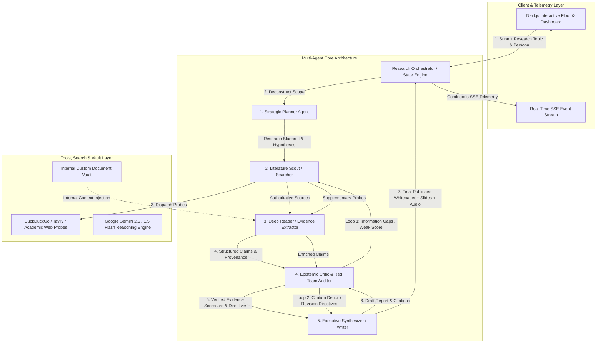

# Multi-Agent Research and Report Factory: Design Document

## 1. Executive Summary & Architecture Overview
The **Multi-Agent Research and Report Factory** is an autonomous multi-agent intelligence platform engineered to autonomously plan, discover, extract, audit, and synthesize research into verifiable, cited reports.

---

## 2. Agent Roles & Cognitive Responsibilities

| Agent Name | Persona / Avatar | Cognitive Role & Responsibilities | Tool Invocations & Output |
| :--- | :--- | :--- | :--- |
| **Strategic Planner** | 🧭 `Planner` | Deconstructs the research query into taxonomic sub-questions, frames testable hypotheses, establishes search vector queries, and plans report sections. | Outputs `ResearchPlan` (sub-questions, target queries, core hypotheses). |
| **Literature Scout** | 🔍 `Searcher` | Executes multi-perspective search queries, probes academic/web endpoints, deduplicates domains, and evaluates initial candidate relevance. | Invocations: Web Probes, Search APIs. Outputs `SearchSource[]`. |
| **Deep Reader** | 📖 `Reader` | Mines reference documents, extracts quantitative statistics, historical events, expert quotes, and assigns per-fact confidence scores. | Parsing heuristics, JSON extraction. Outputs `ExtractedFact[]`. |
| **Epistemic Critic** | ⚖️ `Critic` | Audits domain credibility, flags commercial bias, detects logical fallacies, conducts adversarial Red Team stress-tests, and triggers replanning loops. | Scoring algorithms, hallucination audit. Outputs `CriticReview` and `DraftReportAudit`. |
| **Executive Synthesizer** | ✍️ `Writer` | Synthesizes verified evidence into exhaustive markdown reports with inline footnote citations `[^1]`, executive summaries, comparative tables, and audio briefing dialogues. | Footnote generator, persona adaptation, revision executor. Outputs `FinalReport`. |

---

## 3. Orchestration Pattern: Evaluator-Optimizer with Dynamic Replanning
Our multi-agent system avoids rigid linear execution by implementing an **Evaluator-Optimizer Orchestration Pattern** with bidirectional state cycles:

1. **Critic-Driven Search Replanning (Loop 1)**:
   - When the **Critic Agent** evaluates extracted claims against research hypotheses, it detects knowledge gaps (e.g., missing 2025/2026 economic data or unresolved counter-theses).
   - If `overallCredibilityScore < 85` or `criticDecision === 'request_more_evidence'`, the Critic generates targeted follow-up queries (`followUpSearchQueries`).
   - The Orchestrator re-invokes the **Searcher Agent** with `executeTargeted()`, followed by the **Reader Agent**, and re-audits the enriched evidence bank.

2. **Critic Post-Draft Verification & Anti-Hallucination Revision (Loop 2)**:
   - The **Writer Agent** produces an initial draft report.
   - The **Critic Agent** audits the draft using `auditDraftReport()`, checking whether assertions have valid footnote citations `[^index]` and whether commercial claims are tempered with academic caveats.
   - If ungrounded statements are found or `score < 85`, the Critic passes structured `revisionDirectives` back to the Writer, which performs a targeted rewrite before publication.

3. **Loop Termination Safeguards**:
   - Max iteration limits (`maxLoops = 2`) ensure convergence and prevent infinite agent cycles.

---

## 4. Technology Choices & Justification

- **Framework & Runtime**: Next.js (App Router, React 18, TypeScript) with server-side API streaming.
  - *Justification*: Provides sub-millisecond local state updates, zero-friction deployment on Vercel/Node, and native Server-Sent Events (SSE) for streaming agent thought streams.
- **AI Reasoning Engine**: `@google/generative-ai` (Gemini 2.5 Flash / 1.5 Flash).
  - *Justification*: 1M+ token context window enables deep multi-document parsing with high-speed JSON schema compliance and cost-effective multi-agent reasoning.
- **Search & Retrieval**: Multi-provider Search Service (DuckDuckGo HTML Probes, Tavily API, Academic Repositories).
  - *Justification*: Redundant web probe architecture with graceful fallbacks ensures zero downtime during live evaluations.
- **UI & Visualization**: Tailwind CSS, Framer Motion, Lucide Icons, React Markdown with GFM & Highlight.js.
  - *Justification*: Clean glassmorphic cyber-interface providing real-time telemetry, agent thought feeds, and interactive report rendering.
